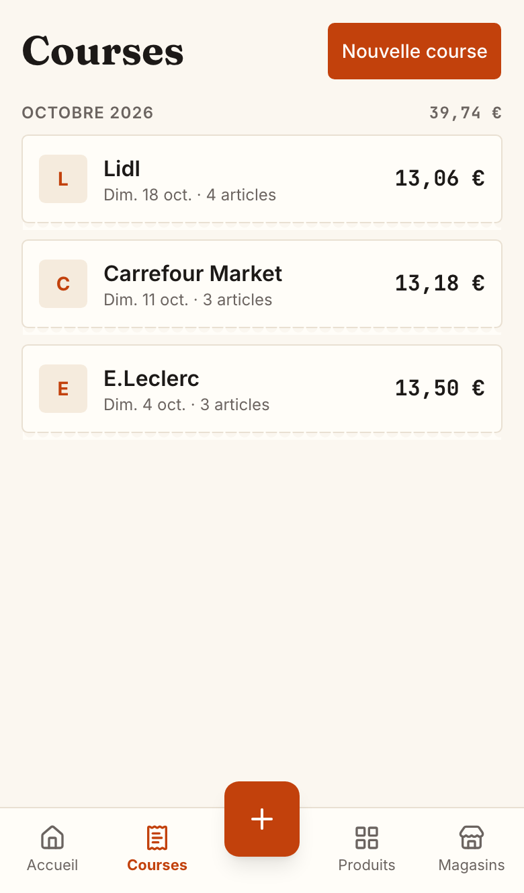
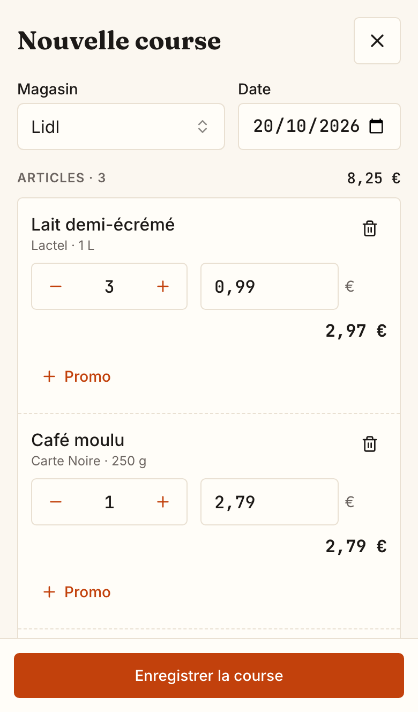
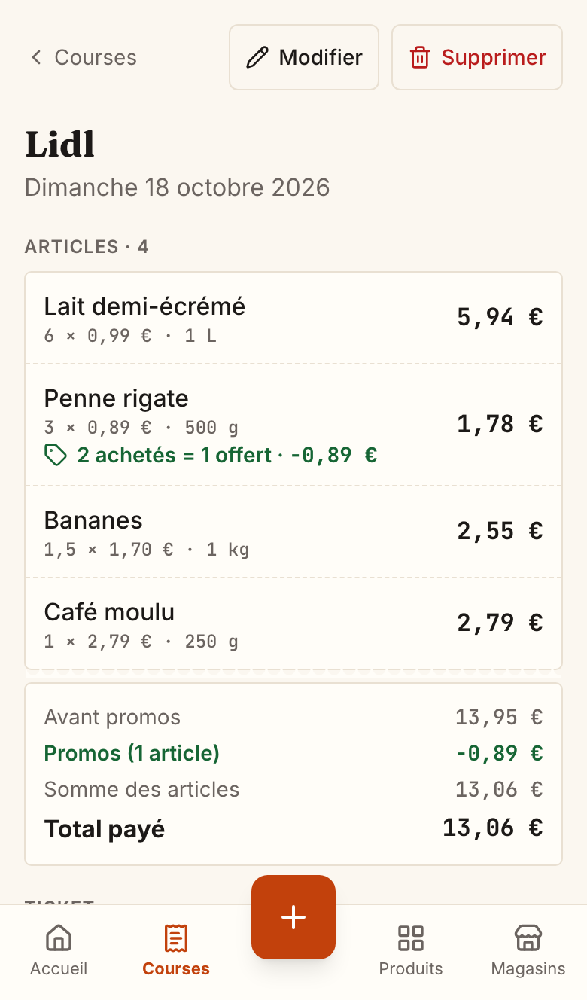
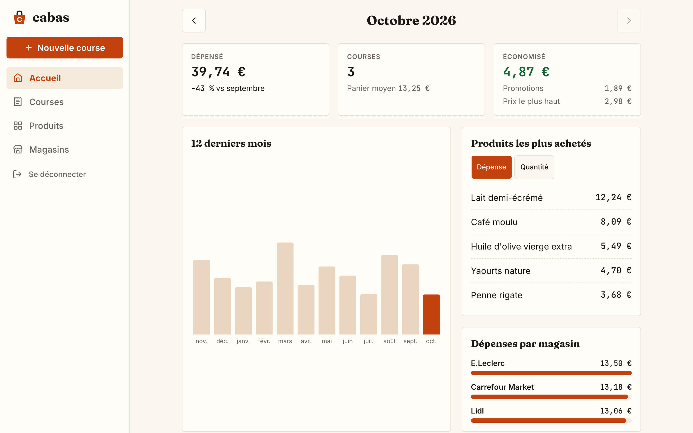
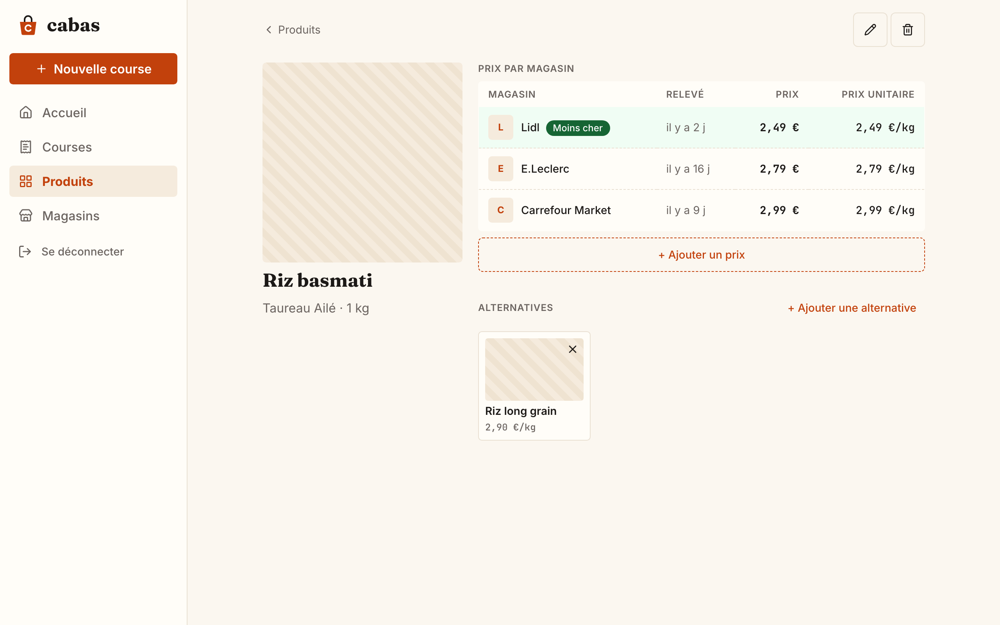

# cabas

**A personal notebook for your grocery shopping: what you bought, where, and for how much.**

A *cabas* is the French word for a shopping tote. The app is just as simple: after each trip to
the supermarket, you note what you bought on your phone. Over time, cabas remembers every price
in every store, and tells you where each product is cheapest.

  
  &nbsp;
  
  &nbsp;
  

## Why cabas?

Prices change all the time, and they are never the same from one store to the next. Is coffee
cheaper at Lidl or at Leclerc? Was that "3 for 2" deal really a bargain? How much did groceries
cost this month?

Receipts end up in the bin and nobody remembers prices. cabas keeps them for you, without a
spreadsheet and without effort: a few taps right after shopping, and the comparison builds
itself.

## What you can do

### Note a shopping trip in a few minutes

Pick the store, then add what you bought. If cabas already knows the product, it fills in the
last price you paid **in that store**: you only change it if it went up or down. New products
can be created on the spot, without leaving the screen.

- Change quantities with **+** and **−**, or type a weight for loose products (1.5 kg of bananas).
- Add the **promotions** printed on the receipt: money off, a percentage off, "the 2nd one at
  −50 %", or "2 bought = 1 free". cabas works out the real amount you paid, and keeps the
  normal price aside so comparisons stay fair.
- Type the total from the receipt: cabas shows the gap if it doesn't match the sum of the items,
  so you spot a forgotten line straight away.
- Take a **photo of the receipt** to keep it with the trip.
- Interrupted by a phone call? The trip in progress is saved on the phone until you finish it.

### Look back at your spending

Every trip is listed by month, with the total spent. Open one to see each item, the promotions,
the receipt photo, and change or delete it if you made a mistake.

### See where your money goes

The home page sums up the month: how much you spent and how it compares with the month
before, how many trips you made and your average basket, your most bought products, and what
each store cost you. A chart shows your spending over the last 12 months, and the arrows at the
top take you back to any earlier month.

cabas also tells you **how much you saved**: through promotions, and by buying in a store that
was cheaper than the most expensive one you know for the same product.

  

### Find the cheapest store for each product

Each product has its own page with its latest price **in every store**. The cheapest one is
highlighted, and prices are also shown **per kilo, per litre or per piece**, so a 500 g pack can
be compared fairly with a 1 kg one. You can also add a price you saw without buying (in a store
or a leaflet).

When two products can replace each other (two brands of rice, for example), link them as
**alternatives** to see at a glance which one is better value.

  

### On your phone and on your computer

cabas is made for the phone first, in the aisles or at the checkout, but it works just as well
on a computer. Everything is in one place: what you enter on one shows up on the other, with
nothing to sync.

You can also add cabas to your phone's home screen: it then opens like an app, with its own
icon. It needs an internet connection to work.

- iPhone (Safari): Partager › Sur l’écran d’accueil.
- Android (Chrome): menu ⋮ › Installer l’application.

## Coming next

**Shopping lists**: prepare your list at home, see what it would cost in each store, tick items
off while shopping, then turn the list into a recorded trip in one tap.

## Your data stays at home

cabas is not an online service run by a company. It runs on a small personal server at home,
and is protected by a password. There is no account to create, no advertising, and nothing is
shared with anyone: your purchases, prices and receipt photos never leave your own machine.
A backup of everything can be scheduled, every night for example.

The app is in French.

## Installation

Hosting cabas requires some technical knowledge (a server with Docker). The steps are in
[INSTALL.md](INSTALL.md).
